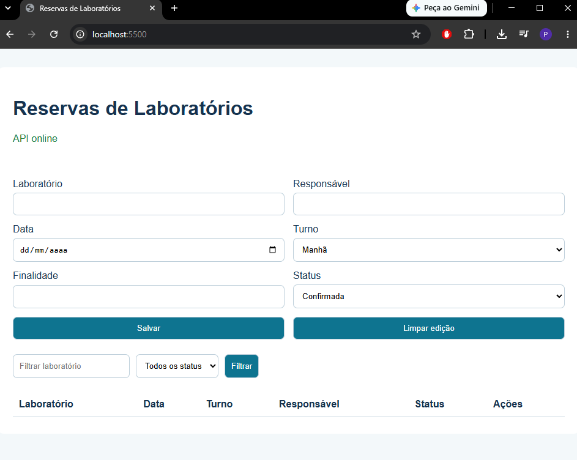
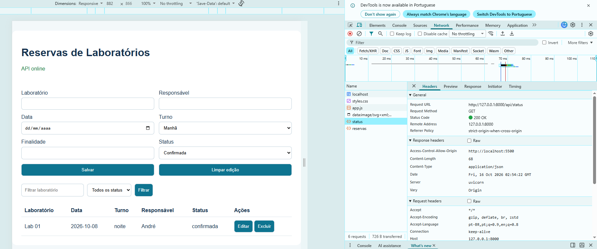

# Atividade 9
**Projeto:** Sistema de Reservas de Laboratórios
**Alunos:** Douglas Vignoli, Kaylan Lorete e Pedro Almeida

---

## 1. Aplicação executando
API (terminal 1):
```powershell
cd backend
.\.venv\Scripts\Activate.ps1
uvicorn main:app --reload
```
Front-end (terminal 2):
```powershell
cd frontend
py -m http.server 5500
```
A API rodou em `http://127.0.0.1:8000` e a página em `http://localhost:5500`, mostrando "API online".


---

## 2. Camadas e arquivos
| Arquivo | Camada | Responsabilidade |
|---|---|---|
| `backend/main.py` | API | cria a aplicação FastAPI e registra as rotas |
| `backend/requirements.txt` | ambiente | lista as dependências Python |
| `frontend/index.html` | apresentação | estrutura da página |
| `frontend/styles.css` | apresentação | aparência e layout |
| `frontend/app.js` | integração | chama a API e atualiza a página |

---

## 3. Requisição GET com resposta 200
| Campo | Valor |
|---|---|
| Request URL | `http://127.0.0.1:8000/api/status` |
| Method | `GET` |
| Status Code | `200 OK` |
| Response | `{"status":"online","sistema":"Sistema de Reservas de Laboratórios"}` |

No terminal do Uvicorn apareceu a linha `"GET /api/status HTTP/1.1" 200 OK`.



---

## 4. Percurso dos dados
O navegador carrega o `index.html` pela porta 5500. O `app.js` faz um `fetch` GET para `/api/status` na porta 8000. O Uvicorn recebe a requisição e o FastAPI chama a função `status()` do `main.py`. Ela retorna um dicionário, que é convertido em JSON e enviado com código 200. O `app.js` lê esse JSON e escreve "API online" na página (DOM).

---

## 5. Grupo e responsabilidades
| Integrante | Responsabilidade |
|---|---|
| Douglas Vignoli | back-end (FastAPI) |
| Pedro Almeida | front-end (HTML/CSS) |
| Kaylan Lorete | integração (JavaScript/Fetch) |
| Pedro Almeida | banco de dados e testes |

---

## 6. Proposta de evolução
- Adicionar o campo **quantidade de alunos** (1 a 40) na reserva.
- Cadastrar os **laboratórios com capacidade**, para não deixar reservar acima do limite.
- **Bloquear reservas em datas passadas.**
